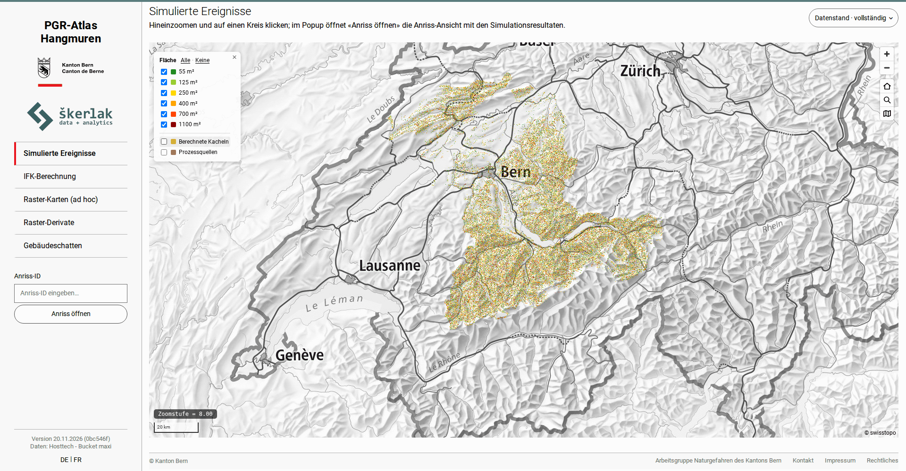

# PGR-Atlas

PGR-Atlas is Kanton Bern's web app for exploring natural hazard simulations, launched first for
hillslope debris flows (Hangmuren) in November 2026. It allows to visualize, analyze and download the results of [ProBE](https://www.naturgefahren.sites.be.ch/de/start/themen/informationen-gemeinden-fachpersonen/neue-beurteilungsgrundlagen-fuer-hangmuren-.html)
(«Probabilistisch modellierte Beurteilungsgrundlagen für den Kanton Bern») as well as to adjust the probabilities according to local expert know-how.

PGR-Atlas shows where hillslope debris flows were simulated to start, how far they reach depending on which physical parameters and how deep, fast and often they flow, calculates intensity-frequency curves and raster maps on demand, and offers pre-calculated data products for the whole canton for download.

**Open the app:** <https://pgr-atlas.apps.be.ch> (test instance:
<https://pgr-atlas-test.apps.be.ch>)



The data are results of numerical simulations, not a hazard map, and have no legal effect; the
approved hazard maps remain authoritative.

**Who runs it.** Kanton Bern, Amt für Wald und Naturgefahren, owns the app and its data. The
app is developed and maintained by [Škerlak Data + Analytics](https://www.skerlak.ch/) and
hosted and operated by [Bedag Informatik AG](https://www.bedag.ch/) on the Kanton Bern
Kubernetes platform. Contacts: [Contact and contributors](#contact-and-contributors).

PGR-Atlas is a Streamlit app with MapLibre maps, built without any paid GIS software licence. This repo holds the app and everything needed to build and deploy it. It is open-source software, licensed
under the [BSD 3-Clause License](LICENSE). The logos are not covered by it
([THIRD-PARTY-LICENSES.md](THIRD-PARTY-LICENSES.md#also-shipped)).

**Where to go next:**

- [CONTRIBUTING.md](CONTRIBUTING.md): how to propose a change, and the
  [Code of Conduct](CODE-OF-CONDUCT.md)
- [SECURITY.md](SECURITY.md): how to report a vulnerability (not in a public issue)
- [docs/README.md](docs/README.md): the map of all documentation, from running the app locally
  to deployment and operations
- [docs/texts-guide.md](docs/texts-guide.md): changing the app's German and French texts
- [docs/glossary.md](docs/glossary.md): the German domain terms (Anriss, Kachel, IFK, …)
  explained in English

## What you can do with it

The app reads everything from the ProBE data lake in object storage. The data lake is filled by
the ProBE simulation pipeline, which is not part of this repository. PGR-Atlas has these
views:

| View | What it is for |
|---|---|
| **Simulierte Ereignisse** | A map of all Anrisse, the places where a hillslope debris flow can start, drawn as circles by size. Click one to open it. |
| **Anriss** | Opens from the Simulierte Ereignisse map (or from IFK-Berechnung). One Anriss under one scenario (a set of model parameters): where the simulated flows reach, how deep, fast and forceful they get, and how often. With statistics and downloads. |
| **IFK-Berechnung** | Intensity-frequency curves (IFK) for depth, velocity and pressure. For one pixel, with the Anrisse that reach it, or for an area you draw or upload. |
| **Raster-Karten (ad hoc)** | Draw an area and get raster maps for it, calculated on demand. |
| **Raster-Derivate** | Browse and download the pre-calculated rasters for the whole canton. |
| **Gebäudeschatten** | Simulations released from building footprints instead of Anrisse: for the whole canton, which areas a flow starting at a building reaches, and which other buildings it affects. Click a building or a pixel for the details. |

IFK-Berechnung and Raster-Karten (ad hoc) have an **Experten-Modus** (beta), in which you can
change the probabilities the calculation uses. The IFK charts then keep the standard curve as a
grey "Original" line for comparison.

Every view, step by step:
[docs/frontend-app/behavior-inventory.md](docs/frontend-app/behavior-inventory.md).

## Where it runs

The canton's test and production instances run on the Kanton Bern Kubernetes platform
hosted by Bedag, both publicly reachable:

| Stage | URL |
|---|---|
| Prod | https://pgr-atlas.apps.be.ch |
| Test | https://pgr-atlas-test.apps.be.ch |

How each is updated: [docs/deployment-process.md](docs/deployment-process.md). To try a change
before it is released, run it locally (below).

The footer of the running app shows its version and which data it reads. Open work is in the
repository's GitHub issues.

## Running locally

The app needs object storage (here referred to as S3 despite not being hosted on AWS) access: it reads the data lake at startup, and the data is too large for local copies or fixtures. Use the test bucket `adelboden-test`, a copy
of the data lake for one region.

Put the settings into a `.env` file in the repo root (it is git-ignored):

```bash
PROBE_S3_ENDPOINT_URL=https://f712.gos3.io
PROBE_S3_BUCKET=adelboden-test
PROBE_S3_ACCESS_KEY_ID=...
PROBE_S3_SECRET_ACCESS_KEY=...
```

The test bucket is not public: its keys are issued by the project owner. Without
them the app stops with a message that names the missing variables.

Only running the app and the e2e and AppTest suites need these keys. The unit tests, the
component tests and Vitest run without any credentials
([tests/README.md](tests/README.md)).

### From the source (recommended for development)

Needs [uv](https://docs.astral.sh/uv/) and Node (version in `frontend/.nvmrc`).
This route also works on Apple Silicon without emulation.

```bash
uv sync                                         # Python packages, exactly as in uv.lock
(cd frontend && npm ci && npm run build)        # the map components
cd app && uv run python run_app.py              # reads ../.env, starts everything
```

Then open http://localhost:8501. `run_app.py` starts three things in one
process: Streamlit (8501), the tile proxy (8505) and the raster crop server
(8503). The maps talk to the other two ports directly, so all three must be
reachable ([Ports and processes](docs/deployment-process.md#ports-and-processes)).

The front-end edit loop is in
[docs/ONBOARDING_FRONTEND.md](docs/ONBOARDING_FRONTEND.md), the tests in
[tests/README.md](tests/README.md).

### From the image

The image is public, so no `docker login` is needed. It is built for amd64
only; on Apple Silicon add `--platform linux/amd64` and expect a slow start.

```bash
docker run --rm -d --name pgr-atlas --env-file .env \
  -p 8501:8501 -p 8505:8505 -p 8503:8503 \
  -e PMTILES_BIND=0.0.0.0 -e DERIVATE_BBOX_BIND=0.0.0.0 \
  ghcr.io/skerlakanalytics/pgr-atlas:latest      # or :main, or a release such as :v0.12.1
```

To build the image yourself: `cd docker && ./build.sh` produces
`pgr-atlas:local` (on Apple Silicon: `DOCKER_DEFAULT_PLATFORM=linux/amd64 ./build.sh`).

`curl localhost:8505/readyz` returns `ok` once Streamlit, the tile proxy and
the crop server all answer. A passing health check does not prove that the app
works: Streamlit runs the script only when a session opens. Open the app in a
browser, or see "Verifying a change" in [app/README.md](app/README.md#verifying-a-change).

## How it is built and deployed

The full description is in
[docs/deployment-process.md](docs/deployment-process.md): architecture and
request path, GitOps and CI, releasing, operating and debugging, and cluster
access. 
How the data reaches the browser, and how a release reaches the clusters:

```
ProBE simulation pipeline (maintained separately)
   │  writes gold, Derivate rasters, PMTiles and the event catalog to Hosttech S3;
   │  the s3-toolbox copies them into each stage's Bedag bucket
   ▼
S3 data lake (one bucket per stage, read-only for the app)
   │  read at runtime through probe-core (S3 access, schema, IFK and raster maths)
   ▼
App pod, behind the canton's front proxy and the Ingress: nginx proxy :8080
   │  /                → Streamlit app (:8501)
   │  /pmtiles-data/   → pmtiles_server (:8505), tile ranges from S3
   │  /derivate-bbox/  → derivate_bbox_server (:8503), raster crops from S3
   ▼
Browser: the Streamlit page with the MapLibre map components

git tag v*  ──"Build and push"──►  image ghcr.io/skerlakanalytics/pgr-atlas:v*
   │  the build opens one pull request per stage that sets image.tag
   ▼
deploy/stages/<stage> on main (merge test's pull request, then prod's)
   │  Flux reads main and applies the stage
   ▼
Bedag clusters kb-common-test and kb-common-prod
   (image pulled through Bedag's mirror artifacts.bedag.cloud)
```

In short:

- **One image, no data.** CI builds `ghcr.io/skerlakanalytics/pgr-atlas` from
  `app/` and `docker/`. The image is public and holds no secrets; everything
  under `app/` becomes public with it. Data and credentials arrive at runtime.
- **Image tags.** A git tag `vX.Y.Z` builds the release `:vX.Y.Z` and moves
  `:latest`. A push to `main` builds `:main`. A manual run on a branch builds
  `:<branch>`.
- **GitOps at Bedag.** Flux in Bedag's clusters reads `main` and applies
  `deploy/stages/test` and `deploy/stages/prod`. Nobody deploys by hand.
- **Releasing.** Tag a commit on `main` and wait for the "Build and push" run.
  It opens one pull request per stage that sets `image.tag` in
  `deploy/stages/<stage>/pgr-atlas/values.yaml`. Merge test's, check test, then
  merge prod's. To roll back, set the previous tag. Never move a version tag.
- **Related:** S3 buckets and the s3-toolbox in [docs/s3.md](docs/s3.md),
  alerting and the dashboard in [docs/monitoring.md](docs/monitoring.md).

## Repo layout

```
app/            The Streamlit app (app.py, run_app.py, …). Shared data-lake, S3 and
                derivate code comes from the probe-core package (see app/README.md).

packages/       probe-core, the package the app shares with the pipeline: S3
                access, data-lake schema and read layer, IFK and raster maths.
                A uv workspace member, installed with `uv sync`.

docker/         Dockerfile + build.sh. The image runs as UID 10001 and bakes in
                DuckDB's httpfs/spatial extensions; no data -- everything comes
                from S3 at runtime.

deploy/stages/  GitOps configuration for Flux + Bedag's `common` Helm chart:
  base/           shared by every stage (HelmRelease, which object types exist)
  base/monitoring/  alert rules and scrape config, the same on every stage
  test/           Bedag test (+ s3-toolbox/: the S3 toolbox pod, see tools/s3/)
  prod/           Bedag prod (+ s3-toolbox/)

deploy/applied-by-bedag/
                Alert mail routing (AlertmanagerConfig) that Bedag applies by hand;
                Flux never reads it (its README)

tools/s3/       s3m + rclone + AWS CLI image for managing the S3 buckets at
                Hosttech and Bedag and copying between them (tools/s3/README.md)

tools/proxy/    the nginx image in front of the app in each pod: its single entry
                port (tools/proxy/README.md)

tools/texts_status.py
                lists the texts in app/texts.toml still missing French

monitoring/grafana/
                the Grafana dashboard per stage, as exported JSON (its README)

.github/workflows/
  ci.yml               hooks, lint, workflow audit (on PRs; gates a release)
  unit.yml             unit tests (on PRs that change what they read; gates a release)
  frontend.yml         frontend/ checks and map-component tests (on PRs that
                       change what they read; gates a release)
  build-and-push.yml   builds and pushes the image
  e2e.yml              browser tests against the test bucket, for a release
  apptest.yml          AppTest against the test bucket, for a release
  build-s3tools.yml    builds the s3tools image on s3tools-v* tags
  build-proxy.yml      builds the proxy image on proxy-v* tags
  cleanup-images.yml   daily: deletes untagged image versions older than 1 day
  scan-images.yml      weekly: Trivy re-scan of the images the stages run;
                       opens an issue when red and closes it when green

frontend/       The map components (TypeScript, MapLibre), built into
                app/<component>/dist/ (frontend/README.md)

tests/          Unit, component, e2e and AppTest suites (tests/README.md)

docs/           Guides: frontend onboarding (start with ONBOARDING_FRONTEND.md),
                Bedag architecture and operations (deployment-process.md), S3
                buckets and s3m (s3.md), monitoring (monitoring.md).
                docs/README.md indexes them all.

AGENTS.md       The quick reference for everyday work, for people and coding
                assistants: setup, commands, the rules a linter can't enforce,
                and where to change what.

CONTRIBUTING.md, CODE-OF-CONDUCT.md, SECURITY.md, LICENSE, THIRD-PARTY-LICENSES.md
                How to contribute, the Code of Conduct, reporting a vulnerability,
                the license and the open source software the app ships
```

At the root, `AGENTS.md` is the quick reference for people and coding assistants, `CLAUDE.md`
only imports it for one coding assistant, `.sops.yaml` is the SOPS configuration for the
encrypted secrets under `deploy/stages/`, and `aw3-gitops-sops.asc` is the deployment's public
encryption key that SOPS encrypts them for.

## Configuration

Everything is set through environment variables; no `.env` is baked into the
image. The variables, where the Bedag stages set them, and how to encrypt a
secret are in [app/README.md](app/README.md#configuration).

## Test data

Local runs and tests use `adelboden-test`, a copy of the data lake for one region (about
609 GB). What is in it and how it is built:
[docs/s3.md](docs/s3.md#the-adelboden-test-bucket).

## Contact and contributors

- **Project owner and subject-matter contact:** Kanton Bern, Amt für Wald und Naturgefahren,
  Fachstellen Naturgefahren, Schloss 2, 3800 Interlaken,
  [contact form](https://www.naturgefahren.sites.be.ch/de/start/ueber-uns/kontaktformular.html)
- **Application development:** [Škerlak Data + Analytics](https://www.skerlak.ch/)
- **Hosting and operation:** [Bedag Informatik AG](https://www.bedag.ch/), on the Kanton Bern
  Kubernetes platform

To contribute, read [CONTRIBUTING.md](CONTRIBUTING.md) and the
[Code of Conduct](CODE-OF-CONDUCT.md). Report a vulnerability as [SECURITY.md](SECURITY.md)
says, not in a public issue.
